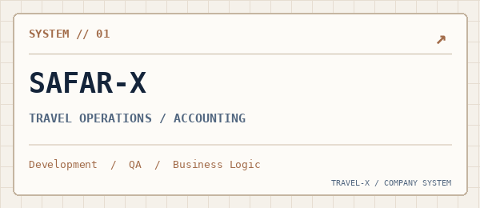
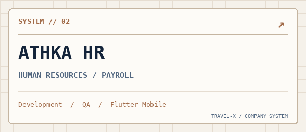
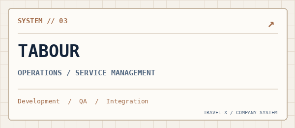
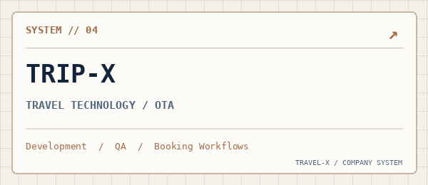

  
  

  <a href="https://al-akhali.github.io/"><b>PORTFOLIO</b></a>
  &nbsp; // &nbsp;
  <a href="https://www.linkedin.com/in/anasalakhali/"><b>LINKEDIN</b></a>
  &nbsp; // &nbsp;
  <a href="mailto:alakhalianas@gmail.com"><b>CONTACT</b></a>

<!-- PROFESSIONAL EXPERIENCE / TRAVEL-X -->

<table>
<tr>
<td width="50%" valign="top"><a href="https://www.txsaas.online/products/safar-x/"><picture><source media="(prefers-color-scheme: dark)" srcset="assets/professional-safar-x-dark.png"><source media="(prefers-color-scheme: light)" srcset="assets/professional-safar-x-light.png"></picture></a></td>
<td width="50%" valign="top"><a href="https://www.txsaas.online/products/athka-hr/"><picture><source media="(prefers-color-scheme: dark)" srcset="assets/professional-athka-hr-dark.png"><source media="(prefers-color-scheme: light)" srcset="assets/professional-athka-hr-light.png"></picture></a></td>
</tr>
<tr>
<td width="50%" valign="top"><a href="https://www.txsaas.online/products/tabour/"><picture><source media="(prefers-color-scheme: dark)" srcset="assets/professional-tabour-dark.png"><source media="(prefers-color-scheme: light)" srcset="assets/professional-tabour-light.png"></picture></a></td>
<td width="50%" valign="top"><a href="https://www.txsaas.online/products/tayran/"><picture><source media="(prefers-color-scheme: dark)" srcset="assets/professional-trip-x-dark.png"><source media="(prefers-color-scheme: light)" srcset="assets/professional-trip-x-light.png"></picture></a></td>
</tr>
</table>

ADDITIONAL CONTRIBUTIONS // Flutter Mobile · AI Chatbots & Agents · System Integration · Deployment & Hosting

Travel-X team contributions · Company-owned repositories · Public product pages only

<!-- END PROFESSIONAL EXPERIENCE -->

  <a href="https://al-akhali.github.io/en/">Case Studies</a>
  &nbsp;·&nbsp;
  <a href="https://www.linkedin.com/in/anasalakhali/">LinkedIn</a>
  &nbsp;·&nbsp;
  <a href="mailto:alakhalianas@gmail.com">Email</a>

