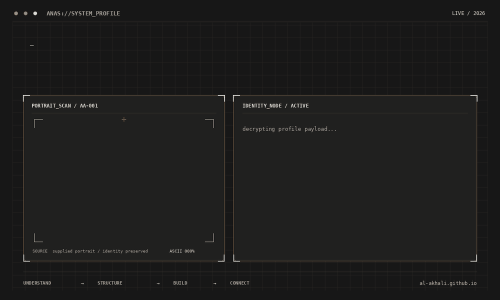
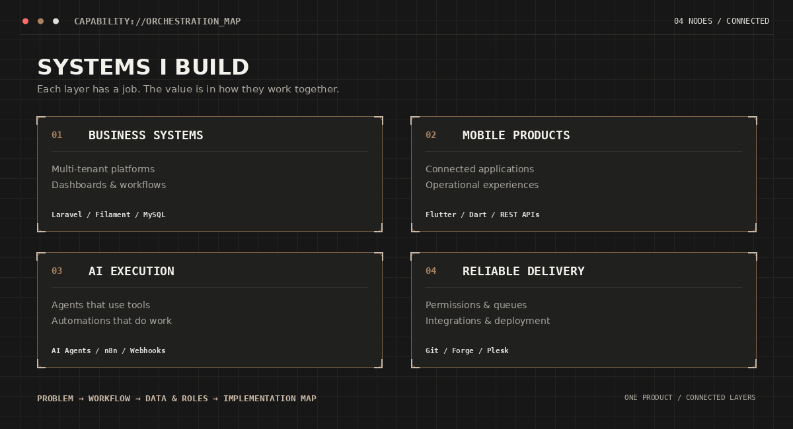
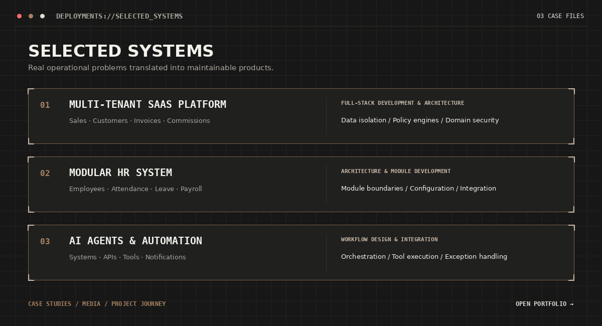
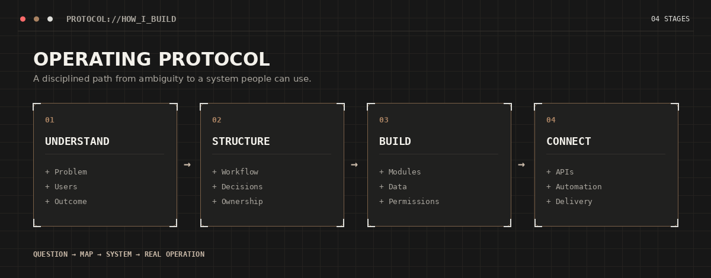
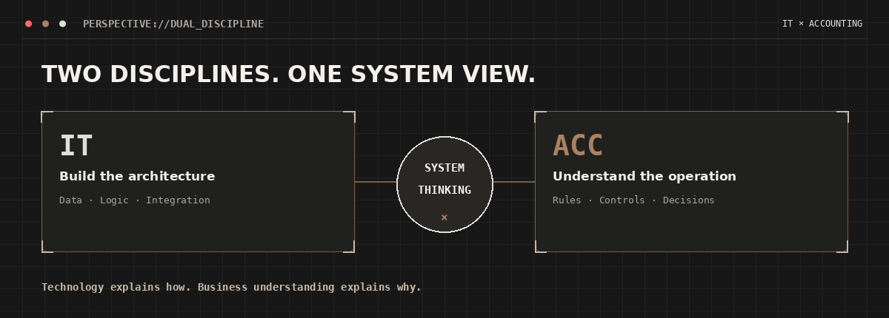
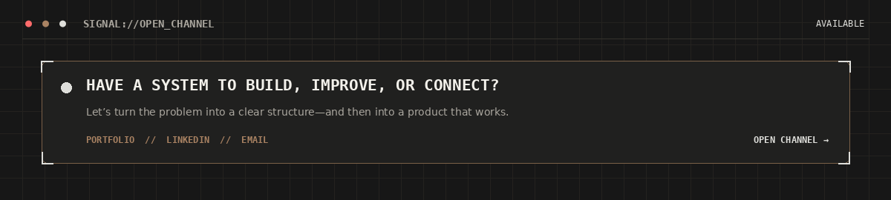

  <picture>
    <source media="(prefers-reduced-motion: reduce)" srcset="assets/anas-system-profile.png">
    
  </picture>

  <a href="https://al-akhali.github.io/"><b>PORTFOLIO</b></a>
  &nbsp; // &nbsp;
  <a href="https://www.linkedin.com/in/anasalakhali/"><b>LINKEDIN</b></a>
  &nbsp; // &nbsp;
  <a href="mailto:alakhalianas@gmail.com"><b>CONTACT</b></a>

  <a href="https://al-akhali.github.io/en/">Case Studies</a>
  &nbsp;·&nbsp;
  <a href="https://www.linkedin.com/in/anasalakhali/">LinkedIn</a>
  &nbsp;·&nbsp;
  <a href="mailto:alakhalianas@gmail.com">Email</a>

