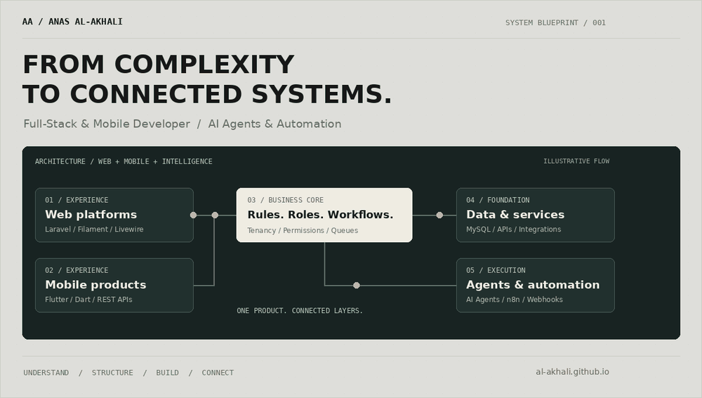
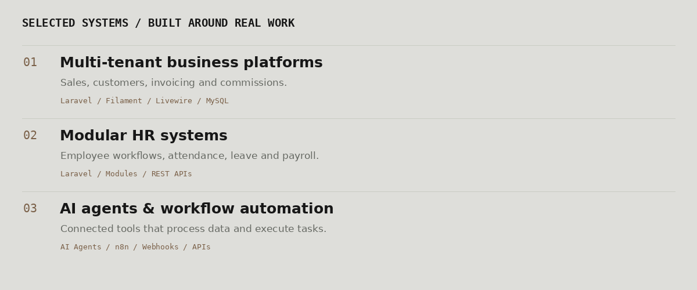

  <picture>
    <source media="(prefers-reduced-motion: reduce)" srcset="assets/system-blueprint.png">
    
  </picture>

  <a href="https://al-akhali.github.io/">Portfolio & case studies ↗</a> &nbsp; · &nbsp;
  <a href="https://www.linkedin.com/in/anasalakhali/">LinkedIn ↗</a> &nbsp; · &nbsp;
  <a href="mailto:alakhalianas@gmail.com">Start a conversation ↗</a>

### I build the connections that make a product work.

I'm **Anas Al-Akhali**, a developer based in Sana’a, Yemen. I build business platforms, mobile applications, and AI agents that connect to systems and APIs to execute practical workflows.

My work starts with the problem: understand the people, map the workflow, define the data and permissions, then turn that structure into software that can grow.

---

### 01 / What I build

| Discipline | Work I focus on | Core tools |
| :--- | :--- | :--- |
| **Business systems** | Multi-tenant platforms, admin dashboards, modular applications and financial workflows | Laravel · Filament · Livewire · MySQL |
| **Mobile products** | Flutter applications connected to backend services and real business operations | Flutter · Dart · REST APIs · Firebase |
| **AI & automation** | Agents, tool integrations, event-driven workflows and notifications | AI Agents · n8n · Webhooks · APIs |
| **Backend & delivery** | Permissions, queues, integrations and deployment | Laravel · Git · Forge · Plesk |

### 02 / Selected work

**Multi-tenant business platform** — Full-stack development and architecture, with a focus on data isolation, operational policies and domain security.

**Modular HR system** — Architecture and module development, with a focus on separation of concerns, configurable modules and integration.

**AI agents & automation** — Workflow design and integration, with a focus on tool execution, orchestration and exception handling.

[Explore project context and media in my portfolio →](https://al-akhali.github.io/en/)

### 03 / How I approach a system

- **Understand the work.** Identify the real problem, users and outcome.
- **Make the workflow explicit.** Map decisions, ownership and failure paths.
- **Define the boundaries.** Connect roles, permissions, data and integrations.
- **Build for everyday use.** Think about maintenance, delivery and growth from the start.

### 04 / Technology × business understanding

My background combines **Information Technology** and **Accounting**. That combination shapes how I approach operational and financial software: understand what the business needs to happen, then make the rules clear in the system.

---

  <strong>Have a system to build, improve, or connect?</strong> 
  <a href="mailto:alakhalianas@gmail.com">Let’s turn the problem into a working product.</a>

Web · Mobile · Systems · Automation

